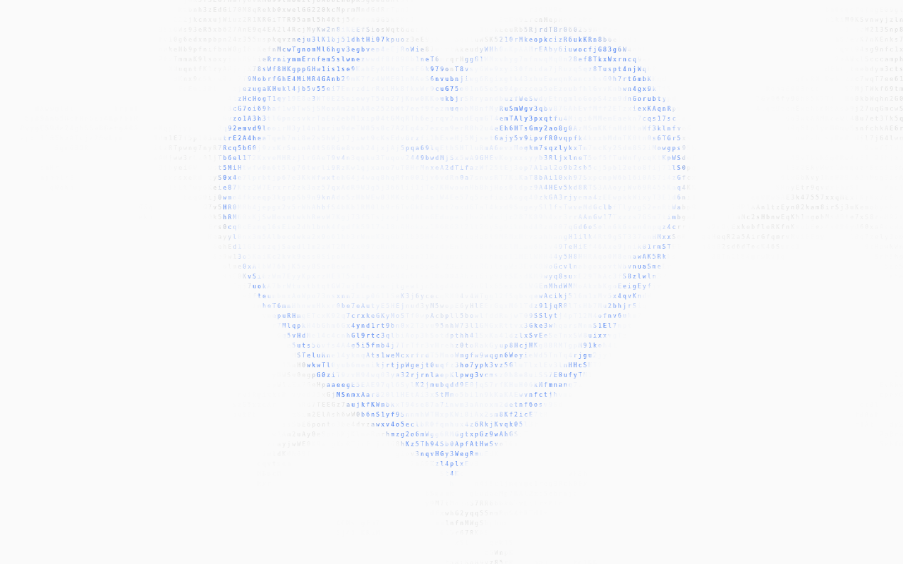

# Clow Waves Web

A standalone, interactive **WebGL2 ASCII wave / digital ripple background** for personal sites and web apps, with a Canvas 2D fallback.

> **Attribution first:** This repository is a web adaptation of **[Orgtree's Claude Waves](https://github.com/Maurdekye/orgtree/blob/main/docs/rust-engine/canvas-background-themes.md)**. The **core ASCII wind-field mathematics, glyph selection, heart/circular ripple physics, and WebGL2 pipeline** are substantially adapted from the MIT-licensed work of **Maurdekye**. The web component lifecycle, additional presets, standalone demo, framework integration, and fallback are adaptations/additions around that work. See [PROVENANCE.md](PROVENANCE.md), [THIRD_PARTY_NOTICES.md](THIRD_PARTY_NOTICES.md), and [LICENSE](LICENSE).

**Independent and unofficial:** This project is **not affiliated with, endorsed by, or sponsored by Anthropic**. Claude and Anthropic are trademarks of their respective owners. It does not distribute Anthropic proprietary code, installer assets, logos, fonts, or official recordings. Visual similarity does not imply authorization by Anthropic.

[简体中文文档 / Chinese instructions](README.zh-CN.md)

## Features

- Flowing character field driven by multiple noise scales, rather than randomly scattered letters.
- Pointer motion wakes and expanding click ripples; by default every third click produces a heart-shaped ripple.
- Warm/light/dark appearance presets, deterministic seed, adjustable speeds, character pools, and strengths.
- WebGL2 renderer with basic Canvas 2D fallback; both work without a backend or remote API.
- Traditional script, ESM, isolated section, and React/Next.js integration examples.
- Pause on hidden tabs, reduced-motion support, resize handling, `destroy()` cleanup.

## Try the demo

**[Open the live demo → https://clow-waves-web.pages.dev/](https://clow-waves-web.pages.dev/)** — deployed with Cloudflare Pages; pushes to `main` automatically update the site.

🌐 **Language:** The live demo is **English-first**. Click **中文** in the top-right corner to switch the entire UI to Chinese, and **EN** to switch back. The choice is saved locally; use `?lang=en` or `?lang=zh` to link to a specific locale. Language switching does not restart the ripple field.

**Offline, no installation:** Download and open [`digital-ripples-standalone.html`](digital-ripples-standalone.html). Click the empty background to generate ripples; press **H** to toggle the interface, and use the controls to change the preset and shape.

For deployment, publish the contents of `dist/` to **Cloudflare Pages** (project build output: `dist`, no build command required because distribution files are checked in). Git integration can redeploy automatically on push when authorized. See [DEPLOYMENT.md](DEPLOYMENT.md).

Alternatively open [`dist/index.html`](dist/index.html) while keeping its JS/CSS files together. Serving `dist/` over HTTP also works. No server-side functionality is required.



## Quick start — plain HTML

Copy `dist/digital-ripples.js` into your website and insert:

```html
<div id="ripples" aria-hidden="true"
     style="position:fixed;inset:0;pointer-events:none;z-index:0"></div>

<main style="position:relative;z-index:1">
  <!-- Your site content -->
</main>

<script src="./digital-ripples.js"></script>
<script>
  const waves = new DigitalRipples('#ripples', {
    preset: 'reference',   // 'reference' | 'warm' | 'dark'
    shape: 'auto',         // 'auto' | 'ripple' | 'heart'
  });
</script>
```

For partial regions, see [`examples/section.html`](examples/section.html). Interactive UI elements are ignored by default; add `data-ripple-ignore` to an element or region to exclude it from triggering clicks.

### ESM / React

Use `dist/digital-ripples.module.js`, which exports `DigitalRipples`. Instantiate inside a browser-mounted effect and call `destroy()` during cleanup. See [`examples/ReactBackground.jsx`](examples/ReactBackground.jsx). No React dependency is needed to use the core component.

### JavaScript API

```js
await waves.ready;
waves.ripple(300, 200);                        // container-local CSS coordinates
waves.ripple(450, 250, { shape: 'heart' });
waves.setOptions({ speed: 0.85, rippleOpacity: 0.3 });
waves.setPreset('warm');
waves.pause();
waves.resume();
waves.getStats();
waves.destroy();
```

Options include `preset`, `shape`, `glyphPool`, `scale`, `speed`, `ambientOpacity`, `rippleOpacity`, `seed`, `backgroundColor`, `inkColor`, `rippleColor`, `fps`, `idleFps`, `idleAfter`, `interactive`, `pointerWake`, `respectReducedMotion`, `renderer`, and `fontFamily`. See the [complete API reference and options table](README.zh-CN.md#参数) (currently in Chinese).

## Build and test

Compiled distribution files are committed so users can drop them directly into a site. To modify the sources, use **Node.js ≥ 22.18** (no third-party build packages are required):

```bash
npm run build
npm run check
```

The source is in `src/`. `scripts/build.mjs` bundles the standalone browser files. Build tools use Node's built-in TypeScript type stripping.

## Repository layout

| Path | Purpose |
| --- | --- |
| `src/field.ts`, `src/gl.ts` | Adapted upstream field mathematics and WebGL2 renderer |
| `src/controller.js`, `src/fallback.js` | Portable component, interactions, and fallback |
| `dist/` | Built standalone JS, ESM/types, interactive demo |
| `digital-ripples-standalone.html` | Complete self-contained offline HTML demo |
| `examples/` | Vanilla HTML, region, and React examples |
| `scripts/` | Build script and lifecycle tests |
| `preview/` | Rendered demonstration stills (not Anthropic assets) |
| `PROVENANCE.md`, `THIRD_PARTY_NOTICES.md` | Source attribution and license records |

## License and provenance

Licensed under the [MIT License](LICENSE), which retains **Copyright (c) 2026 Maurdekye**. You must preserve the copyright notice and MIT permission terms when distributing copies or substantial portions of the adapted upstream software. Review [PROVENANCE.md](PROVENANCE.md) for the exact source files, Git blob identifiers, upstream's independently documented study process, modifications and known limitations.

This adaptation is **not a claim of original authorship of the ripple engine**. It is an effort to package and document a web-portable version of the upstream feature. For a pixel-perfect replica of the original Claude UI, official authorization and source access would be required; none is represented here.
