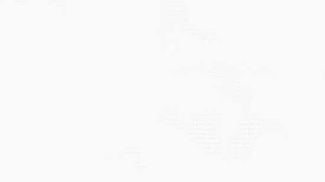

# Clow Waves Web · 可嵌入网页的数字波纹

<p align="center">
  <a href="./README.md">English</a> | <a href="./README.zh-CN.md">简体中文</a>
</p>

交互式 ASCII 字符流与数字涟漪，可独立运行，也可以嵌入个人网站。

[](https://clow-waves-web.pages.dev/?lang=zh)

**[▶ 在线体验](https://clow-waves-web.pages.dev/?lang=zh)** · [English demo](https://clow-waves-web.pages.dev/?lang=en)

> **语言说明：** 网页演示默认英语，右上角可切换「中文 / EN」，也可以通过 `?lang=zh` 直接打开中文界面；切换不会重启波纹动画。本页面顶部的 English / 简体中文则用于切换两份完整的 GitHub README 文档。

根据两段 Claude Desktop 参考视频重建的流动字符背景与点击特效。提供浏览器可直接运行的成品、可独立接入的组件、源码和 React 示例。

## 先看效果

直接双击根目录的 **`digital-ripples-standalone.html`**。它包含全部 CSS 和 JavaScript，离线可用，不必安装 Node.js、不必启动服务器。

网页初始状态是很浅的灰色字符云。点击空白处产生蓝紫色波纹，自动模式下按“圆形、圆形、心形”循环；快速移动鼠标会在字符云里留下较弱的扰动。第三次点击计数延续到当前组件被清空或卸载。

右上角“预设”提供视频二纸白、视频一暖白、深色扩展；“调节”可以选择形状、字符池，调整大小、浓度和速度。“纯背景”或 **H** 隐藏前景界面；按 H、Esc 或右下角小按钮恢复。下方输入框是本地波纹演示，输入“爱心”或“圆形”后按 Enter 可指定形状。

双击 `dist/index.html` 也可以运行，但须保留同目录的 JS 和 CSS。使用 HTTP 静态服务器时可访问 `?clean=1` 纯背景、`?demo=1` 点击示范、`?preset=warm` 暖白、`?seed=1701` 固定随机种子。这些参数也可以组合。

## 最小接入：普通 HTML

把 **`dist/digital-ripples.js`** 复制到网站目录，加入以下代码：

```html
<div id="ripples" aria-hidden="true"
     style="position:fixed;inset:0;z-index:0;pointer-events:none"></div>

<main style="position:relative;z-index:1">
  <!-- 正常放置你的网页内容、链接、按钮和表单 -->
</main>

<script src="./digital-ripples.js"></script>
<script>
  const effect = new DigitalRipples('#ripples', {
    preset: 'reference',
    shape: 'auto',
  });
</script>
```

组件监听当前文档中的指针事件，按容器实际位置换算坐标，因此背景自身可保持 `pointer-events:none`。链接、按钮、输入框、下拉框和 `contenteditable="true"` 区域自动排除；对整块区域或其他可编辑组件加 **`data-ripple-ignore`** 可排除其中所有点击。组件不阻止浏览器默认滚动、文字选择和表单行为。

网页前景如果有不透明背景，会遮住其后的特效。根据你的布局，把特效放入正确层级，或让需要显示波纹的区域使用透明背景。

完整示例：`examples/vanilla.html`。

## 只放在某一区域

父区域设置 `position:relative`，背景子元素绝对铺满，前景正常排版：

```html
<section style="position:relative;height:500px">
  <div id="hero-ripples" aria-hidden="true"
       style="position:absolute;inset:0;pointer-events:none"></div>
  <div style="position:relative;z-index:1">你的首页内容</div>
</section>
<script src="./digital-ripples.js"></script>
<script>
  const hero = new DigitalRipples('#hero-ripples', { preset: 'warm' });
</script>
```

完整滚动示例：`examples/section.html`。区域滚出视口时暂停，回到视口时继续；点击坐标按当时的容器位置重新计算。

## React / Next.js / Vite

将 `dist/digital-ripples.module.js` 与对应 `.d.ts` 复制到项目中，参考 `examples/ReactBackground.jsx`。ESM 文件是独立构建，不依赖 `window` 全局导出；导入本身可用于 SSR，实例创建必须在浏览器挂载阶段进行。

```jsx
'use client';
import { useEffect, useRef } from 'react';
import { DigitalRipples } from './digital-ripples.module.js';

export default function Background() {
  const host = useRef(null);
  useEffect(() => {
    const effect = new DigitalRipples(host.current, { preset: 'reference' });
    return () => effect.destroy();
  }, []);
  return <div ref={host} aria-hidden="true"
    style={{ position: 'fixed', inset: 0, pointerEvents: 'none', zIndex: 0 }} />;
}
```

不要在 React render 函数中创建实例。路由切换或组件卸载时调用 `destroy()`，避免残留监听和渲染循环。

## 参数

| 参数 | 默认值 | 用途 |
| --- | --- | --- |
| `preset` | `'reference'` | `'reference'` 纸白 / `'warm'` 暖白 / `'dark'` 深色扩展 |
| `shape` | `'auto'` | `'auto'` 圆、圆、心循环；或固定 `'ripple'` / `'heart'` |
| `glyphPool` | `'mixed'` | `'mixed'` / `'lettered'` / `'figured'` 三套定序字符池 |
| `scale` | `1` | 整体视觉尺度，包括字符大小、场景和波纹尺寸；0.55–2.5 |
| `speed` | `1` | 风场、字符变换和波纹时间的统一倍率；0.15–3 |
| `ambientOpacity` | `0.075` | 环境字符相对浓度；0–0.6。它是调节参数，不是最终 CSS alpha |
| `rippleOpacity` | `0.4` | 点击高亮和残留尾迹相对浓度；0–1 |
| `backgroundColor` | 预设值 | 六位十六进制；`null` 保留宿主原背景 |
| `inkColor` | 预设值 | 环境字符颜色，六位十六进制 |
| `rippleColor` | 预设值 | 波纹颜色，六位十六进制 |
| `seed` | `526526` | 固定随机种子；相同 seed、尺寸、字体和时间可重现同一场 |
| `interactive` | `true` | 是否自动响应鼠标和触屏；关闭后仍可调用 `ripple()` |
| `pointerWake` | `true` | 是否响应快速鼠标移动；触屏不生成移动尾迹 |
| `respectReducedMotion` | `true` | 系统要求减少动态时显示静态字符场，关闭自主运动与点击动画 |
| `maxDpr` | `2` | 最大设备像素倍率；总缓冲区另有约2100万像素上限 |
| `fps` | `60` | 有交互时的目标帧率，并非硬件帧率保证 |
| `idleFps` | `25` | 只有环境风场时的目标帧率 |
| `idleAfter` | `180` | 无有效交互多少秒后逐渐归于平静；`0` 表示可见时持续运行 |
| `introDuration` | `1.5` | 初次出现的淡入秒数；`0` 立即显示 |
| `renderer` | `'auto'` | 首选 WebGL2，失败时 Canvas 2D；也可显式指定两者之一 |
| `fontFamily` | 系统等宽字体列表 | 字体会影响字符边缘和视觉密度；可使用网站已加载的等宽字体 |
| `calmCentre` | `[0.5, 0.45]` | 较平静的中心区域，按容器比例定位 |
| `calmRadii` | `[250, 80]` | 中心平静区的横纵半径，以场景逻辑像素计 |
| `eventTarget` | 当前文档 | 在构造时自定义指针事件监听目标 |

参考视频受窗口尺寸、缩放和录屏采样影响。第一段测得字符网格约7×14像素，第二段约8.75×17.5像素。优先保持默认尺寸；若在同等画幅下第二段的字更大，可把 `scale` 调到1.25左右。

## API 与生命周期

```js
await effect.ready;                     // 初始化完成；检查 getStats().renderer/phase
effect.ripple(300, 200);                // 坐标为容器内 CSS 像素
effect.ripple(500, 260, { shape: 'heart', strength: 1 });
effect.setOptions({ speed: 0.8, ambientOpacity: 0.06 });
effect.setPreset('warm');               // 切换预设并清空当前波纹
effect.pause();
effect.resume();
effect.clear();                         // 清空波纹/尾迹，并重置点击计数
console.log(effect.getOptions());
console.log(effect.getStats());
effect.destroy();                      // 释放 GPU、监听、观察器和定时器
```

`ready` 在异步初始化结束时兑现。如果所有渲染上下文都不可用，组件会发出 `error` 事件，`getStats().phase` 为 `unavailable`。容器过小、不可见或已销毁时不会继续绘制。改变字体、字符池、seed 或渲染器会重建实例内部的渲染资源，`effect.ready` 更新为本次初始化的 Promise。

宿主元素事件：`ready`、`ripple`、`statechange`、`error`。`ripple` 的 `event.detail` 包含 `{ x, y, shape, count }`。

组件会响应 `document.visibilitychange`、容器大小变化、进入/离开视口以及 WebGL 上下文丢失与恢复。`pause()` 是显式暂停，点击不会解除它；程序需要先调用 `resume()`。

## 确定性复现与截图

```js
await effect.ready;
effect.renderAt(8, [
  { at: 7.2, x: 640, y: 400, shape: 'heart', strength: 1 }
]);
// 冻结在时刻8秒，此时心形波纹年龄0.8秒。
effect.resume();
```

`renderAt()` 是明确的冻结/对照接口，不会继续自动播放。`dist/index.html?qa=1` 提供隔离的静态、圆形和心形按钮，普通页面不显示这些控件。

## 还原依据与边界

实现采用固定字符格、带多个尺度的流动风场、不同字符自己的变换节奏、风向相关的字形笔画明暗、点击引起的场位移、外层波前、内层周期环带以及蓝色衰减尾迹。波纹中的 U 形轮廓来自内层波带与风场叠加，没有添加独立的眼睛或嘴巴图标。

主要数学来自 MIT 项目 [Orgtree 的 Claude Waves](https://github.com/Maurdekye/orgtree/blob/main/docs/rust-engine/canvas-background-themes.md)，对应源码见 `THIRD_PARTY_NOTICES.md`。上游声明它依据 Claude Desktop 的背景算法进行独立重建。本交付没有取得 Anthropic 官方源码，也无法从录屏恢复原来那次会话的随机种子、精确字体栅格化和完整录制参数，因此不声称逐像素相同或“100%官方实现”。

保留的关键传播参数：

```text
波前半径 R(t) = 620 × (1 − exp(−t / 1.3))
波带宽度 W(t) = 85 + 60t
内部周期环带间隔 = 130 逻辑像素
单个点击记录寿命 = 3.6秒
同时保留最多6个点击、48段鼠标尾迹
```

这些参数能产生先快后慢的扩散、较厚的波带、内层弧线和渐弱的残影。视频中的可见强波纹通常在记录寿命结束之前就已经很淡。

两个浅色预设依据视频底色和观感设置；深色是额外提供的个人网页选项。`Canvas 2D` 降级模式使用同一风场数学，但减少采样密度并近似笔画照明，视觉精度与帧率低于 WebGL2。最高还原度请使用 WebGL2 路径。

## 构建、托管与文件

运行成品不需要任何包管理器。只有修改 `src/` 后重新生成分发文件，才需要 **Node.js 22.18+**：

```bash
npm run build
npm run check
```

构建使用 Node 自带类型擦除功能，无第三方构建依赖；出现 `ExperimentalWarning: stripTypeScriptTypes` 是 Node 对该 API 的提示。

将 `dist/` 内容放到现有静态托管或自己的 Web 服务器即可。Nginx、Caddy、Apache 或现有前端项目均只需要把这些文件当作普通静态资源提供。该特效不调用后端，不发送输入内容或指针坐标，不需要 API key；它的计算本身发生在访问者设备上。

| 文件 | 用途 |
| --- | --- |
| `digital-ripples-standalone.html` | 完整离线演示，一个文件 |
| `dist/index.html` / `demo.css` / `demo.js` | 带可调界面的演示 |
| `dist/digital-ripples.js` | 传统 `<script>` 接入，暴露 `window.DigitalRipples` |
| `dist/digital-ripples.module.js` / `.d.ts` | 独立 ESM 与 TypeScript 类型 |
| `src/field.ts` / `gl.ts` | 风场数学与 WebGL2 管线 |
| `src/controller.js` / `fallback.js` | 通用组件生命周期与降级渲染 |
| `examples/` | 普通网页、局部区域和 React 示例 |
| `scripts/build.mjs` | 可重复生成全部分发文件 |
| `LICENSE` / `THIRD_PARTY_NOTICES.md` | 许可与具体来源 |
| `VALIDATION.md` | 本次实际检查结果及验证范围 |

保留许可证即可按 MIT 条款使用和修改。文件包不包含参考录屏或任何账户信息。

## 来源、版权与许可

核心特效主要改编自 **[Maurdekye/orgtree](https://github.com/Maurdekye/orgtree)**。Copyright (c) 2026 Maurdekye，采用 **MIT License**；再次分发相关代码时必须保留原作者的版权和许可声明。完整来源、许可及移植说明参见 [LICENSE](LICENSE)、[THIRD_PARTY_NOTICES.md](THIRD_PARTY_NOTICES.md) 和 [PROVENANCE.md](PROVENANCE.md)。

**本项目为非官方社区作品，与 Anthropic 不存在隶属、赞助或认可关系。** Claude、Anthropic 为其权利人所有的商标。本仓库不分发 Anthropic 的专有应用文件或官方录屏；视觉相似不代表获得 Anthropic 授权。
